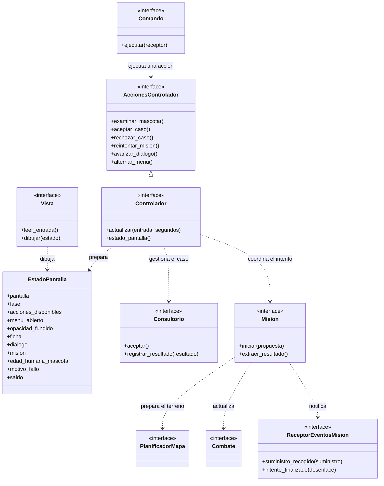
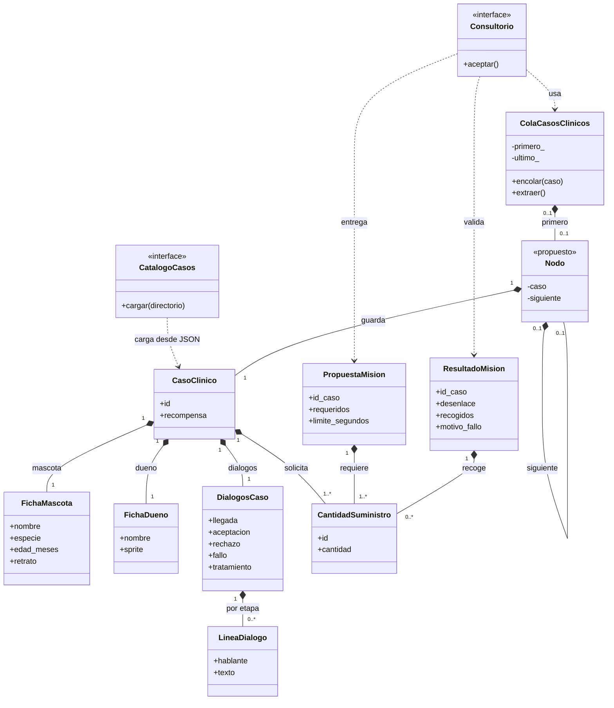
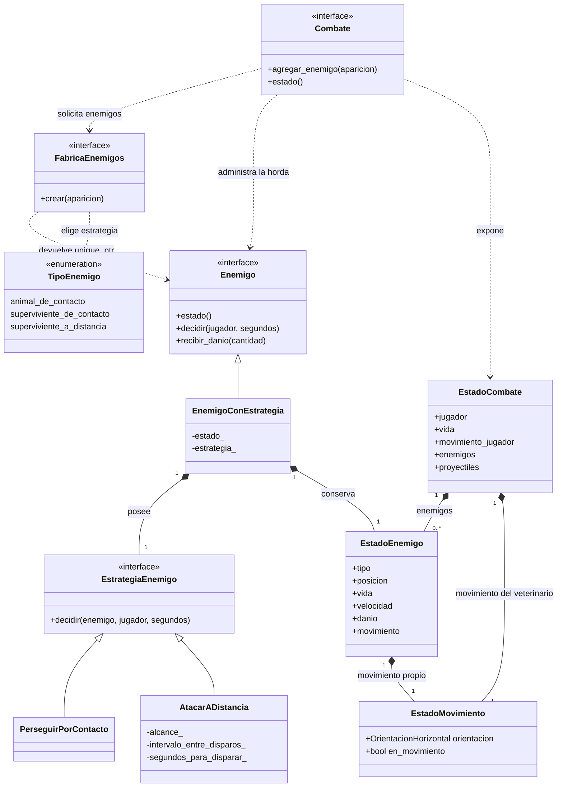
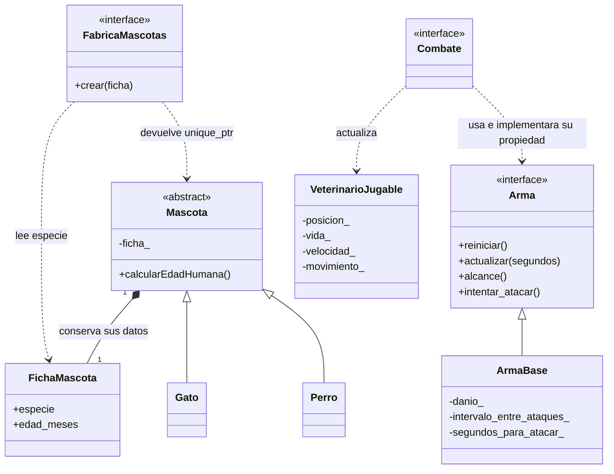

# Veterinaria 2D

Proyecto final de Teoría de Objetos. Tras el colapso, el veterinario atiende
mascotas en un consultorio improvisado y sale a buscar suministros. En la
misión puede cruzarse con animales agresivos y supervivientes hostiles.
La primera entrega apunta a dos mascotas.
Cada caso se define en un JSON con su dueño, su mascota, diálogos y uno o más
suministros con cantidades. Al aceptar la ficha, el veterinario busca esos
suministros en una misión con oleadas y un arma automática. Al recoger la
última cantidad necesaria, la pantalla se oscurece y el veterinario vuelve a
la clínica para completar el tratamiento.

Esta base contiene contratos C++ en cabeceras `.h` y documentación. El equipo
implementará los `.cpp`, los archivos JSON, los recursos y la compilación del
juego. Raylib se usará desde la vista.

## Arquitectura MVC

| Parte | Responsabilidad |
|---|---|
| [Modelo](src/modelo/README.md) | Carga las fichas, administra la cola, aplica las reglas de clínica y simula la misión. |
| [Controlador](src/controlador/README.md) | Interpreta las acciones, coordina el paso entre pantallas y decide qué línea de diálogo mostrar. |
| [Vista](src/vista/README.md) | Lee la entrada y dibuja la ficha, los diálogos, el escenario y el HUD con raylib. |

## Reparto entre cinco personas

| Frente | Primera tarea independiente |
|---|---|
| 1. [Consultorio](src/modelo/clinica/README.md) | Implementar la cola y el flujo de clínica con fichas creadas a mano. Probar con resultados de misión simulados. |
| 2. [Mapa y misión](src/modelo/mision/mapa/README.md) | Diseñar un escenario, ubicar suministros y programar oleadas. Probar la recolección y el fin del intento con un combate simulado. |
| 3. [Catálogo](src/modelo/catalogo/README.md) | Definir dos fichas y cargar sus JSON con dueño, diálogos y suministros. Verificar la carga en consola. |
| 4. [Combate](src/modelo/mision/combate/README.md) | Implementar jugador, arma y enemigos. Probar el movimiento con terreno fijo y apariciones manuales. |
| 5. Controlador y vista | Dibujar las pantallas con estados de ejemplo y probar las transiciones con un consultorio y una misión simulados. |

El [formato de datos](datos/README.md) y las [rutas de arte](arte/README.md)
permiten preparar contenido en paralelo. Quien use ComfyUI en Windows puede
entregar los PNG al frente de interfaz.

## Pantalla de la clínica

La clínica se presenta como una escena de novela visual. El dueño y la mascota
aparecen en el consultorio y el diálogo se muestra abajo. Al pulsar **Examinar
mascota**, se abre la ficha lateral con los datos de la mascota y la lista de
suministros. Desde esa ficha se acepta o se rechaza el caso. El [README de la
vista](src/vista/README.md) muestra el boceto y la secuencia de pantallas.

## Ritmo de la misión y arte

El límite inicial es de **cinco minutos por caso**. Recoger el último
suministro termina el intento en el momento. Si se agota el reloj con
suministros pendientes, el veterinario vuelve a la clínica y puede reintentar.
Las oleadas empiezan dispersas y se hacen más densas con el tiempo.

Para el pixel art, la [guía de arte](arte/README.md) propone azul petróleo y
rojo ladrillo como base, con crema para el contraste y verde menta para los
suministros.

## Patrones y principios

- **Command** representa examinar, aceptar, rechazar, reintentar, avanzar diálogo y abrir o cerrar el menú.
- **Factory** construye mascotas a partir de la ficha y enemigos a partir de apariciones.
  **Strategy** decide cómo se mueve y ataca cada enemigo.
- **Observer** se representa con `ReceptorEventosMision`. La vista concreta
  recibe avisos para el sonido al recoger un suministro o terminar el intento.
- **SOLID** guía la separación. El consultorio desconoce el formato JSON,
  planificar oleadas y ejecutar combate son responsabilidades distintas, y el
  controlador puede trabajar con implementaciones intercambiables de las
  interfaces. Una estrategia nueva se añade como implementación de su contrato.

En la misión, **WASD** mueve al veterinario. El contacto recoge suministros y
activa el ataque del arma básica. **Esc** abre o cierra el menú de pausa. Las
fases, los comandos y la propiedad de la ficha se detallan en el
[README del controlador](src/controlador/README.md).

Las familias de clases tienen subcarpetas propias dentro de su módulo.
`catalogo/mascota/` reúne las mascotas y su fábrica. `combate/enemigo/`
reúne los enemigos, sus estrategias y su fábrica. `combate/arma/` reúne
las armas. `VeterinarioJugable` está directamente en `combate/`.

## Diagrama UML

El [PDF](docs/uml_veterinaria.pdf) reúne las cuatro vistas que aparecen aquí.
[Fuente editable en LaTeX](docs/uml_veterinaria.tex).

Los diagramas muestran las declaraciones de las cabeceras y las relaciones
que el equipo implementará. `Nodo` aparece con los atributos propuestos porque
la cola todavía solo declara ese tipo interno. En el
[catálogo](src/modelo/catalogo/README.md), la ficha clínica reúne tipos que se
declaran por separado.

### MVC y transiciones

### Ficha, cola y objetivo

`primero_` es dueño del primer nodo y `ultimo_` apunta al último para que
encolar tome tiempo constante. Cada nodo interior pertenece al enlace
`siguiente` del nodo anterior. La definición de `Nodo` y de sus operaciones
queda a cargo del equipo.

### Combate, herencia y sprites

La vista elige el sprite con la orientación izquierda o derecha y el estado
de movimiento. El terreno conserva el inicio, los obstáculos y las posiciones
de los suministros. El estado de la misión incluye el tiempo restante. La
misión termina al reunir todas las cantidades pedidas, al quedarse sin vida
o al agotarse el reloj.

### Mascotas y armas

