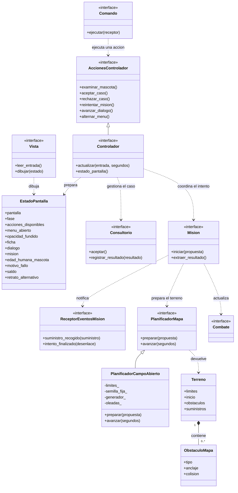
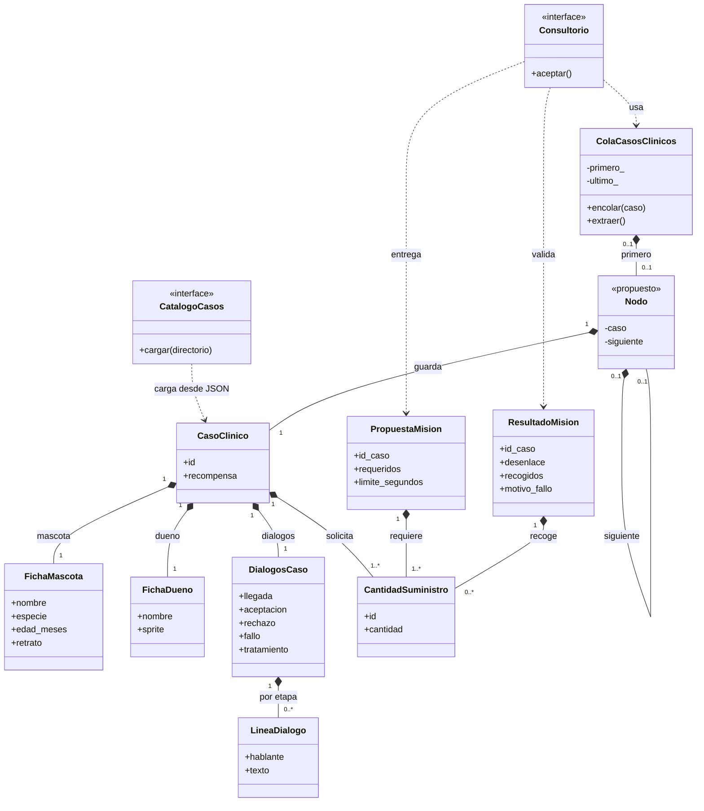
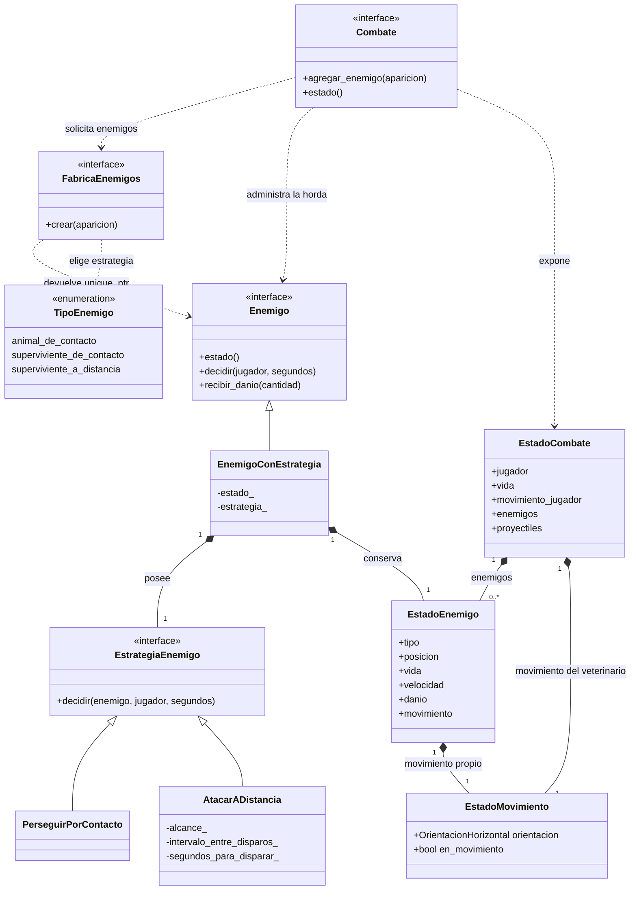
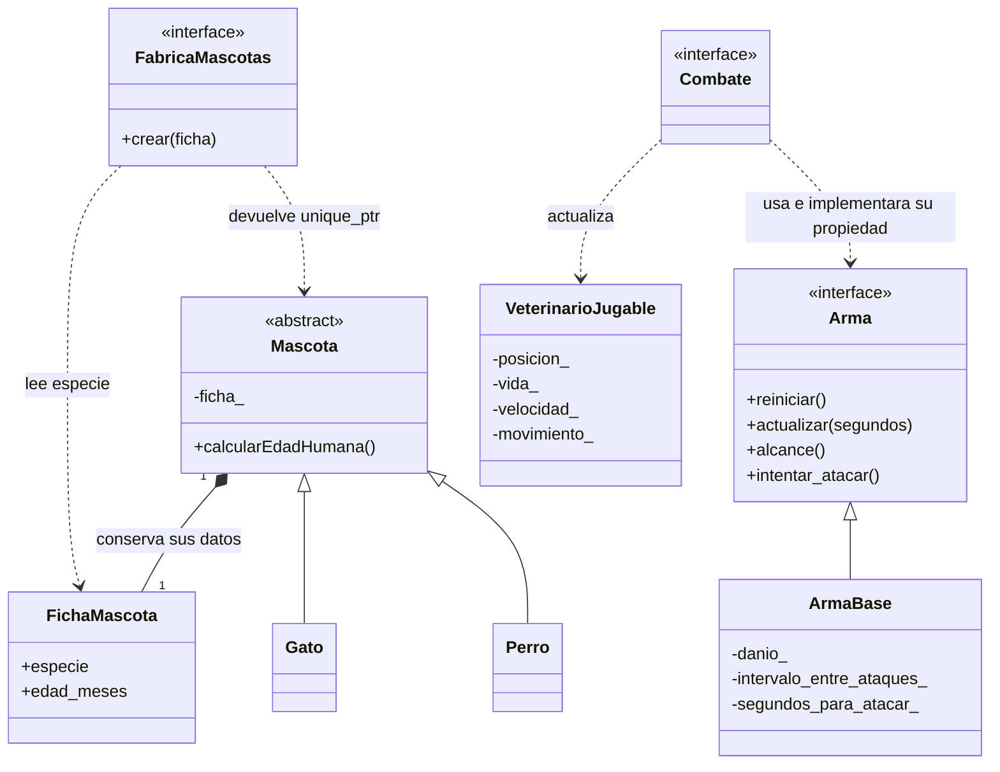

# Veterinaria 2D

Proyecto final de Teoría de Objetos. Tras el colapso, el veterinario atiende
mascotas en un consultorio improvisado y sale a buscar suministros. En la
misión puede cruzarse con animales agresivos y supervivientes hostiles.
La primera entrega apunta a dos mascotas.
Cada caso se define en un JSON con su dueño, su mascota, diálogos y uno o más
suministros con cantidades. Al aceptar la ficha, el veterinario busca esos
suministros en una misión con oleadas y un arma automática. Al recoger la
última cantidad necesaria, la pantalla se oscurece y el veterinario vuelve a
la clínica para completar el tratamiento.

La primera versión de la vista permite recorrer la portada, el consultorio
y una misión de prueba. Usa dos fichas de ejemplo. El catálogo JSON, el mapa
procedural y el combate se integrarán cuando estén disponibles sus módulos.

## Abrir en Qt Creator

1. En Qt Creator, abre [veterinaria.pro](veterinaria.pro) y selecciona un kit
   de escritorio Qt 5 o Qt 6 con un compilador que soporte C++17.
2. Cada rol añade sus `.cpp` en `src/`. El proyecto toma las cabeceras de
   `src/` y también admite `include/` para la estructura de entrega.
3. En la configuración de ejecución, usa la raíz del repositorio como
   directorio de trabajo para cargar los PNG de `arte/`. Qmake compila el
   ejecutable `veterinaria` en `bin/` dentro del directorio de compilación.

En Linux se puede configurar y compilar también desde la raíz:

```bash
mkdir -p build/qt
(cd build/qt && qmake ../../veterinaria.pro && make)
./build/qt/bin/veterinaria
```

Usa `qmake6` en ese comando si tu kit es de Qt 6. La vista requiere raylib.
En Linux la biblioteca debe ser visible con `pkg-config --exists raylib`. En Windows
define `RAYLIB_DIR` con la ruta de la distribución de raylib para tu kit.
Debe contener `include/raylib.h` y `lib/libraylib.a` para MinGW o
`lib/raylib.lib` para MSVC.

Pulsa **Jugar** para abrir la clínica. Usa el ratón para avanzar el diálogo,
examinar y decidir. En la misión, muévete con **WASD**, toca los suministros
para recogerlos y usa **Esc** para pausar o reanudar.

En pausa, **Guardar progreso** escribe un punto de guardado local. Al volver
a abrir el juego, **Jugar** lo carga y **Nueva partida** empieza de cero.
**Reiniciar partida** vuelve al primer caso tras pedir confirmación. Una
partida nueva o reiniciada reemplaza el guardado anterior al pulsar
**Guardar progreso**. **Salir** cierra el juego.

## Arquitectura MVC

| Parte | Responsabilidad |
|---|---|
| [Modelo](src/modelo/README.md) | Carga las fichas, administra la cola, aplica las reglas de clínica y simula la misión. |
| [Controlador](src/controlador/README.md) | Interpreta las acciones, coordina el paso entre pantallas y decide qué línea de diálogo mostrar. |
| [Vista](src/vista/README.md) | Lee la entrada y dibuja la ficha, los diálogos, el escenario y el HUD con raylib. |

## Reparto entre cinco personas

| Rol | Entrega | Primera prueba independiente |
|---|---|---|
| **1. [Consultorio](src/modelo/clinica/README.md)** | Cola propia, caso activo, reintento, tratamiento y cobro. | Crear dos fichas en C++ y cerrar un caso con un resultado simulado. |
| **2. [Mapa](src/modelo/mision/mapa/README.md) y [misión](src/modelo/mision/README.md)** | Terreno, oleadas, objetivos, reloj, recolección y resultado del intento. | Usar un combate simulado. Mover su posición hasta los suministros y verificar el resultado. |
| **3. [Catálogo](src/modelo/catalogo/README.md) y [arte](arte/README.md)** | Fábrica de mascotas, dos [fichas JSON](datos/README.md) y los PNG para la vista. | Cargar fichas en consola y entregar una primera tanda de PNG para probar escala y contraste. |
| **4. [Combate](src/modelo/mision/combate/README.md)** | Veterinario, arma, enemigos, movimiento, colisiones y daño. | Usar un terreno fijo y crear apariciones manualmente. |
| **5. [Controlador](src/controlador/README.md) y [vista](src/vista/README.md)** | Clínica, misión, comandos, panel de examen, HUD, pausa, fundido e integración. | Dibujar las pantallas con estados de ejemplo y simular el consultorio y la misión. |

### Qué se entrega entre roles

| De quién a quién | Contrato |
|---|---|
| Catálogo → consultorio, a través de integración | `CargaCasos` contiene las fichas válidas; integración las entrega con `Consultorio::recibir()`. |
| Consultorio → misión, a través del controlador | `PropuestaMision` contiene el ID del caso, los suministros con cantidades y el límite de tiempo. |
| Mapa → combate, a través de misión | `Terreno` inicia el combate. Incluye la colisión de cada obstáculo. Cada `Aparicion` lleva el tipo y la posición de un enemigo. |
| Combate → misión | `EstadoCombate` expone la vida y la posición del veterinario, además del estado de enemigos y proyectiles. |
| Misión → consultorio, a través del controlador | `ResultadoMision` lleva las cantidades recogidas, el desenlace y el motivo si falló. |
| Controlador ↔ vista | La vista entrega `EntradaCuadro` y dibuja según `EstadoPantalla`. Los PNG y sus rutas llegan desde arte. |

### Orden de integración y entrega

1. Cada rol revisa su README y prueba su parte con los datos o módulos de ejemplo.
2. El rol 5 conecta la clínica con un caso del catálogo y deja que una misión simulada devuelva un resultado. Comprueba el recorrido desde la llegada y el examen hasta el diálogo de tratamiento y el cobro.
3. Los roles 2 y 4 conectan mapa, oleadas y combate. El rol 5 sustituye la misión simulada y prueba el reloj, la pausa, la recolección y el fundido.
4. Integren la segunda ficha y los PNG. La demo debe permitir atender dos casos distintos y mostrar al menos un reintento que conserve la ficha, reinicie el intento y pague una sola vez al completarlo.

El rol 5 deja el comando de compilación y ejecución para Windows y Linux en
el README cuando el juego se pueda ejecutar. Cada rol define los métodos y
destructores declarados en las cabeceras de sus módulos. Si una cabecera
compartida necesita un cambio, revisarlo con quienes la consumen antes de
integrarlo.

## Ramas, CI y entregas

| Cambio | Flujo |
|---|---|
| Funcionalidad o corrección | Crear la rama desde `develop` y abrir un PR hacia `develop`. |
| Versión estable | Abrir un PR desde `develop` hacia `main`. |
| Entrega de staging | Al entrar un cambio a `develop` y pasar el CI, se genera el paquete del entorno `staging`. |
| Entrega de producción | Al entrar un cambio a `main` y pasar el CI, se genera el paquete del entorno `production`. |

El [workflow](.github/workflows/ci-cd.yml) ejecuta el CI en Linux y Windows.
El check **Verificar integración** requiere que pasen ambos sistemas y que
los PR hacia `main` vengan de `develop` de este mismo repositorio. En
GitHub, configura una regla para `develop` y `main` que exija PR y el
check **Verificar integración** para evitar pushes directos.

Para ejecutar las comprobaciones actuales desde la raíz, usa Python 3 y un
compilador GCC o Clang:

```bash
python pruebas/verificar_base.py
```

La prueba compila cada cabecera por separado en C++17 con advertencias como
errores, valida los identificadores y cantidades del JSON de ejemplo y de las
fichas reales, y comprueba las rutas de los enlaces locales en los README. El
CI verifica también el formato C++ con el mismo comando que usa el hook.

Los paquetes aparecen en **Actions → ejecución → Artifacts**, identificados
por `staging` o `production` y por el commit. El paquete actual es un ZIP de
las fuentes versionadas. Cuando `veterinaria.pro` pueda generar el ejecutable
del juego, el rol 5 añadirá al CI su compilación y empaquetado con los recursos.

### Formato antes del commit

Con Python y `clang-format` instalados, activa el [hook](.githooks/pre-commit)
una vez por clon.

```bash
git config core.hooksPath .githooks
```

El hook comprueba la versión preparada con `git add`. El formato combina
`clang-format` con una línea vacía entre bloques de control consecutivos
del mismo nivel, incluidas las ramas `else` y `catch`.
Para comprobar o aplicar el formato desde la raíz del repositorio, usa estos comandos.

```bash
python pruebas/formato_cpp.py
python pruebas/formato_cpp.py --corregir
```

Para aplicar el formato a un único archivo, añade su ruta al segundo comando.
Después de corregir, vuelve a preparar los archivos que quieras incluir en el commit.

En Linux, GitHub Actions aplica el formateador durante la validación. Si
encuentra cambios, deja el parche en **Actions → ejecución → Artifacts →
formato-cpp** y marca el check como fallido. Desde la rama del PR, puedes
aplicar el parche descargado con `git apply formato-cpp.patch` o ejecutar
el comando de corrección sobre tu copia.

## Cierre técnico según la guía del Lab 10

- **Estructura y compilación.** Abrir el proyecto único `veterinaria.pro`
  en Qt Creator. La entrega final separará las cabeceras en `include/` y los
  `.cpp` en `src/`. Actualmente las cabeceras están en `src/` y el equipo
  todavía debe implementar y probar el programa completo.
- **Pruebas del juego.** Cuando se agregue el ejecutable, comprobar la cola
  vacía y el orden de fichas, un caso rechazado, el regreso al recoger el
  último suministro, el reintento por fallo y el cobro único. Probar también
  que Esc congele la misión y el reloj.
- **Informe y exposición.** Preparar el PDF con introducción, análisis del
  problema, conceptos aplicados, patrones justificados y conclusiones.
  Preparar cinco o seis diapositivas y una demo en vivo. Poner el enlace de
  GitHub en la portada del informe y en la primera diapositiva. Los UML
  existentes sirven de apoyo para explicar el diseño.

## Pantalla de la clínica

La clínica se presenta como una escena de novela visual. El dueño y la mascota
aparecen en el consultorio y el diálogo se muestra abajo. Al pulsar **Examinar
mascota**, se abre la ficha lateral con los datos de la mascota y la lista de
suministros. Desde esa ficha se acepta o se rechaza el caso. El [README de la
vista](src/vista/README.md) muestra el boceto y la secuencia de pantallas.

## Ritmo de la misión y arte

El límite inicial es de **cinco minutos por caso**. Recoger el último
suministro termina el intento en el momento. Si se agota el reloj con
suministros pendientes, el veterinario vuelve a la clínica y puede reintentar.
Las oleadas empiezan dispersas y se hacen más densas con el tiempo.

La [guía de arte retro](arte/README.md) define el lienzo de 640 × 360 px y
los tamaños de los sprites. La clínica usa azul petróleo y rojo ladrillo.
La misión transcurre en un campo abierto con verdes, tierras y obstáculos
dispersos. Usar Pixelify Sans para títulos y Handjet para diálogos y HUD.

[`PlanificadorCampoAbierto`](src/modelo/mision/mapa/planificador_campo_abierto.h)
hereda de `PlanificadorMapa` y declara cómo preparar el campo y las oleadas.
Un [`ObstaculoMapa`](src/modelo/mision/mapa/obstaculo_mapa.h)
lleva su tipo, el anclaje del sprite y el rectángulo de colisión. Combate y
vista reciben el mismo terreno.

## Patrones y principios

- **Command** representa examinar, aceptar, rechazar, reintentar, avanzar diálogo y abrir o cerrar el menú.
- **Factory** construye mascotas a partir de la ficha y enemigos a partir de apariciones.
  **Strategy** decide cómo se mueve y ataca cada enemigo.
- **Observer** se representa con `ReceptorEventosMision`. La vista concreta
  recibe avisos para el sonido al recoger un suministro o terminar el intento.
- **SOLID** guía la separación. El consultorio desconoce el formato JSON,
  planificar oleadas y ejecutar combate son responsabilidades distintas, y el
  controlador puede trabajar con implementaciones intercambiables de las
  interfaces. Una estrategia nueva se añade como implementación de su contrato.

En la misión, **WASD** mueve al veterinario. El contacto recoge suministros y
activa el ataque del arma básica. **Esc** abre o cierra el menú de pausa. Las
fases, los comandos y la propiedad de la ficha se detallan en el
[README del controlador](src/controlador/README.md).

Las familias de clases tienen subcarpetas propias dentro de su módulo.
`catalogo/mascota/` reúne las mascotas y su fábrica. `combate/enemigo/`
reúne los enemigos, sus estrategias y su fábrica. `combate/arma/` reúne
las armas. `VeterinarioJugable` está directamente en `combate/`.

## Diagrama UML

El [PDF](docs/uml_veterinaria.pdf) reúne las cuatro vistas que aparecen aquí.
[Fuente editable en LaTeX](docs/uml_veterinaria.tex).

Los diagramas muestran las declaraciones de las cabeceras y las relaciones
que el equipo implementará. `Nodo` aparece con los atributos propuestos porque
la cola todavía solo declara ese tipo interno. En el
[catálogo](src/modelo/catalogo/README.md), la ficha clínica reúne tipos que se
declaran por separado.

### MVC y transiciones



### Ficha, cola y objetivo



`primero_` es dueño del primer nodo y `ultimo_` apunta al último para que
encolar tome tiempo constante. Cada nodo interior pertenece al enlace
`siguiente` del nodo anterior. La definición de `Nodo` y de sus operaciones
queda a cargo del equipo.

### Combate, herencia y sprites



La vista elige el sprite con la orientación izquierda o derecha y el estado
de movimiento. El terreno conserva el inicio, los obstáculos y las posiciones
de los suministros. El estado de la misión incluye el tiempo restante. La
misión termina al reunir todas las cantidades pedidas, al quedarse sin vida
o al agotarse el reloj.

### Mascotas y armas


